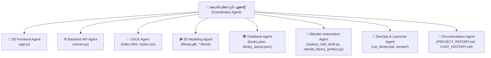

# 🤖 3D സ്മാർട്ട് ലൈബ്രറി - സ്പെഷ്യലൈസ്ഡ് ഏജന്റ് ടീം (Specialized Agent Team Architecture)

ഈ പ്രൊജക്റ്റിലെ ഓരോ പ്രധാന ഫയലിനും നിർദ്ദിഷ്ട ചുമതലകൾക്കായി പ്രത്യേകം ഏജന്റുമാരെ നിയമിച്ചിരിക്കുന്നു (Assigned Agents). ഭാവിയിൽ ഏത് മാറ്റം വരുത്തുമ്പോഴും അല്ലെങ്കിൽ പരിപാലിക്കുമ്പോഴും ഓരോ ഏജന്റും ചെയ്യേണ്ട കൃത്യമായ ഉത്തരവാദിത്തങ്ങൾ താഴെ നൽകുന്നു:

---

## 📌 ഏജന്റ് റോസ്റ്ററും ഫയൽ ചുമതലകളും (Agent Roster & File Assignments)

---

### 1. 🎨 3D Graphics & Interactive Frontend Agent
- **ചുമതലയുള്ള ഫയൽ:** `app.js`
- **റോളും ലക്ഷ്യവും:** Three.js 3D റെൻഡറിംഗ്, ആനിമേഷൻ, പുസ്തകങ്ങളുടെ 3D ഡിസ്‌പ്ലേ, ക്യാമറ ഫ്ലൈത്രൂ, ഇന്ററാക്ഷൻ.
- **ചെയ്യേണ്ട പ്രധാന കാര്യങ്ങൾ:**
  1. **സീൻ & ക്യാമറ:** 3D സീൻ, ഓർബിറ്റ് കൺട്രോളുകൾ, ആർക്കിടെക്ചറൽ സീലിംഗ് എന്നിവ കൈകാര്യം ചെയ്യുക.
  2. **Zero-GPU Fallback:** ബ്രൗസറിൽ ഗ്രാഫിക്സ് കാർഡ് (GPU) ലഭ്യമല്ലെങ്കിൽ തനിയെ ഇന്ററാക്ടീവ് 2D പ്ലാൻ മോഡിലേക്ക് (`render2DLibraryPlan`) മാറുക.
  3. **ബുക്ക് ഫില്ലിംഗ് ലോജിക്:** പുസ്തകങ്ങൾ ഷെൽഫിൽ വെക്കുമ്പോൾ കർശനമായി `Rack 3 (Middle) → Rack 2 → Rack 1 → Rack 4 → Rack 5` എന്ന ക്രമം പാലിക്കുക.
  4. **സെർച്ച് & ക്യാമറ മൂവ്‌മെന്റ്:** ബുക്ക് സെർച്ച് ചെയ്യുമ്പോൾ ക്യാമറ ആ ഷെൽഫിലേക്ക് സുഗമമായി പറന്നു ചെല്ലുന്ന GSAP ആനിമേഷൻ നിലനിർത്തുക.
  5. **മെറ്റീരിയൽ പ്രൊട്ടക്ഷൻ:** ബ്ലെൻഡറിൽ നിന്നുള്ള ഒറിജിനൽ തേക്ക് തടിയുടെ (Teak Wood) PBR ടെക്സ്ചറുകൾ കോഡിംഗിലൂടെ നശിച്ചുപോകാതെ സംരക്ഷിക്കുക.

---

### 2. ⚙️ Backend Server & REST API Agent
- **ചുമതലയുള്ള ഫയൽ:** `server.py`
- **റോളും ലക്ഷ്യവും:** മൾട്ടി-ത്രെഡഡ് പൈത്തൺ HTTP സെർവർ, REST API എൻഡ്‌പോയിന്റുകൾ, ഡാറ്റാബേസ് സേവിംഗ്.
- **ചെയ്യേണ്ട പ്രധാന കാര്യങ്ങൾ:**
  1. **പോർട്ട് 5050 മാനേജ്‌മെന്റ്:** പോർട്ട് 5050-ൽ തടസ്സമില്ലാതെ `ThreadingHTTPServer` റൺ ചെയ്യുക.
  2. **REST APIs:** `/api/books`, `/api/categories`, `/api/layout`, `/api/client-log` എന്നിവയിലൂടെ GET, POST, PUT, DELETE റിക്വസ്റ്റുകൾ സുരക്ഷിതമായി പ്രോസസ്സ് ചെയ്യുക.
  3. **CORS & കാഷിംഗ്:** ബ്രൗസർ സെക്യൂരിറ്റി തടസ്സങ്ങൾ ഒഴിവാക്കാൻ പൂർണ്ണമായ CORS ഹെഡറുകളും നോ-കാഷ് ഹെഡറുകളും നൽകുക.
  4. **ഡാറ്റാ സേഫ്റ്റി:** പുസ്തകങ്ങൾ ആഡ് ചെയ്യുകയോ മാറ്റുകയോ ചെയ്യുമ്പോൾ JSON ഫയലുകൾ കൃത്യമായ utf-8 എൻകോഡിംഗോടെ ബാക്കപ്പ് ചെയ്ത് സൂക്ഷിക്കുക.

---

### 3. ✨ UI/UX & Responsive Layout Agent
- **ചുമതലയുള്ള ഫയലുകൾ:** `index.html`, `styles.css`
- **റോളും ലക്ഷ്യവും:** ഗ്ലാസ്മോർഫിക് മോഡേൺ ഡിസൈൻ, ലോഡിംഗ് സ്ക്രീൻ, മോഡലുകൾ, ഉപയോക്തൃ ഇന്റർഫേസ്.
- **ചെയ്യേണ്ട പ്രധാന കാര്യങ്ങൾ:**
  1. **ടോപ്പ് കൺട്രോൾ ബാർ:** വാതിൽ (Entrance), Overview, റൂം അളവുകൾ (Walls), ഷെൽഫ് & കാറ്റഗറികൾ, ബുക്ക് ആഡ് ബട്ടണുകൾ എന്നിവയുടെ പ്രവർത്തനം സുഗമമാക്കുക.
  2. **ലോഡിംഗ് അനുഭവം:** പുസ്തകം മറിയുന്ന 3D ലോഡറും പുരോഗതി ശതമാനവും കൃത്യമായി പ്രദർശിപ്പിക്കുക.
  3. **മോഡലുകൾ (Modals):** പുതിയ ബുക്ക് ആഡ് ചെയ്യാനുള്ള ഫോം, കാറ്റഗറി എഡിറ്റ് ഫോം, ചുമരുകളുടെ അകലം മാറ്റാനുള്ള സ്ലൈഡർ എന്നിവ നിയന്ത്രിക്കുക.
  4. **മലയാളം ഫോണ്ടുകൾ:** 'Manrope', 'Noto Sans Malayalam' എന്നീ ടൈപ്പോഗ്രാഫികൾ ഭംഗിയായി ലേഔട്ട് ചെയ്യുക.

---

### 4. 🪵 3D Blender Modeling & Asset Agent
- **ചുമതലയുള്ള ഫയലുകൾ:** `library.glb`, `library_shelves_updated.blend`
- **റോളും ലക്ഷ്യവും:** ബ്ലെൻഡർ 3D മോഡലിംഗ്, മെറ്റീരിയലുകൾ, ഒപ്റ്റിമൈസേഷൻ, GLB എക്സ്പോർട്ട്.
- **ചെയ്യേണ്ട പ്രധാന കാര്യങ്ങൾ:**
  1. **ഷെൽഫ് മോഡലുകൾ:** 40 ബുക്ക്‌ഷെൽഫുകളുടെയും മെറ്റൽ റാക്കുകളുടെയും അളവുകളും ജോമെട്രിയും കൃത്യമായി സൂക്ഷിക്കുക.
  2. **ഹാഫ് ഷെൽഫ് അലൈൻമെന്റ്:** Row 3-ൽ സ്ഥാപിച്ചിട്ടുള്ള 1-Bay 5-Row ഹാഫ് ഷെൽഫ് (`Right_Row3_Shelf2`) ഷെൽഫ് 1, 3 എന്നിവയുമായി നേർരേഖയിൽ തന്നെ നിൽക്കുന്നുവെന്ന് ഉറപ്പാക്കുക.
  3. **റൂം ആർക്കിടെക്ചർ:** തറ (Mesh_518), ഭിത്തികൾ (Mesh_519-523), വാതിൽ ഫ്രെയിം (Mesh_524) എന്നിവയുടെ പൊസിഷനും മെറ്റീരിയലുകളും നിയന്ത്രിക്കുക.
  4. **PBR ടെക്സ്ചറുകൾ:** മരത്തിന്റെ തനിമ നിലനിർത്തുന്ന സ്വാഭാവിക വുഡ് ഗ്രെയിൻ ടെക്സ്ചറുകളോടെ മാത്രം ഫയൽ എക്സ്പോർട്ട് ചെയ്യുക.

---

### 5. 📚 Database & Library Catalog Agent
- **ചുമതലയുള്ള ഫയലുകൾ:** `books.json`, `library_layout.json`
- **റോളും ലക്ഷ്യവും:** ലൈബ്രറിയിലെ പുസ്തകങ്ങളുടെ ഡാറ്റ, കാറ്റഗറികൾ, ഷെൽഫ് സ്ഥാനങ്ങൾ എന്നിവയുടെ പൂർണ്ണമായ കണക്ക് സൂക്ഷിക്കൽ.
- **ചെയ്യേണ്ട പ്രധാന കാര്യങ്ങൾ:**
  1. **ബുക്ക് റെക്കോർഡുകൾ:** ഓരോ പുസ്തകത്തിന്റെയും ഐഡി, ബാർകോഡ്, പേര്, എഴുത്തുകാരൻ, കാറ്റഗറി, കവർ നിറം, റാക്ക് നമ്പർ എന്നിവ പരിശോധിക്കുക.
  2. **ഷെൽഫ് മാപ്പിംഗ്:** 40 ഷെൽഫുകളുടെയും കൃത്യമായ 3D കോർഡിനേറ്റുകൾ (`three_pos`), കാറ്റഗറി അസൈൻമെന്റുകൾ (മുൻവശം / പിൻവശം) രേഖപ്പെടുത്തുക.
  3. **ഡാറ്റാ ഇന്റഗ്രിറ്റി:** ഡാറ്റാബേസിലെ വിവരങ്ങൾ സിന്റാക്സ് പിഴവുകളില്ലാതെ കൃത്യമായ JSON ഫോർമാറ്റിൽ സൂക്ഷിക്കുക.

---

### 6. 🐍 Blender Automation & Build Agent
- **ചുമതലയുള്ള ഫയലുകൾ:** `replace_half_shelf.py`, `rebuild_library_perfect.py`
- **റോളും ലക്ഷ്യവും:** ബ്ലെൻഡർ പൈത്തൺ സ്ക്രിപ്റ്റുകൾ വഴി മോഡലുകൾ ഓട്ടോമേറ്റ് ചെയ്ത് നിർമ്മിക്കുകയും എക്സ്പോർട്ട് ചെയ്യുകയും ചെയ്യുക.
- **ചെയ്യേണ്ട പ്രധാന കാര്യങ്ങൾ:**
  1. **ഓട്ടോമേറ്റഡ് റീബിൽഡ്:** കമാൻഡ് ലൈൻ വഴി ബ്ലെൻഡർ റൺ ചെയ്ത് ഷെൽഫുകൾ ആവശ്യമുള്ള സ്ഥാനങ്ങളിൽ ഡ്യൂപ്ലിക്കേറ്റ് ചെയ്യുക.
  2. **കണക്കുകൂട്ടലുകൾ:** രണ്ട് ഷെൽഫുകൾ തമ്മിലുള്ള അകലം (Row distance: 1.49m, Column distance: 1.90m) കൃത്യമായി കണക്കാക്കുക.
  3. **ക്ലീനപ്പ്:** അധികമുള്ള ഒബ്ജക്റ്റുകൾ നീക്കം ചെയ്ത് ഒപ്റ്റിമൈസ് ചെയ്ത `library.glb` ഫയൽ നിർമ്മിക്കുക.

---

### 7. 🚀 DevOps, Zero-GPU Launcher & System Agent
- **ചുമതലയുള്ള ഫയലുകൾ:** `run_library.bat`, `vendor/` ഫോൾഡർ
- **റോളും ലക്ഷ്യവും:** വൺ-ക്ലിക്ക് ലോഞ്ചിംഗ്, എൻവയോൺമെന്റ് ഡിറ്റക്ഷൻ, സീറോ-ജിപിയു (Zero-GPU) ബ്രൗസർ ഫ്ലാഗുകൾ.
- **ചെയ്യേണ്ട പ്രധാന കാര്യങ്ങൾ:**
  1. **പൈത്തൺ ഓട്ടോ-ഡിറ്റക്റ്റ്:** കമ്പ്യൂട്ടറിലെ പൈത്തൺ വേർഷനുകൾ (uv 3.12, uv 3.15, സിസ്റ്റം പൈത്തൺ) സ്വയം കണ്ടെത്തി സെർവർ പ്രവർത്തിപ്പിക്കുക.
  2. **Zero-GPU CPU ഫ്ലാഗുകൾ:** `--ignore-gpu-blocklist --enable-webgl --disable-gpu-watchdog` ഫ്ലാഗുകൾ നൽകി ഏത് കമ്പ്യൂട്ടറിലും GPU ഇല്ലാതെ തന്നെ ബ്രൗസർ തുറക്കുക.
  3. **പോർട്ട് മോണിറ്ററിംഗ്:** സെർവർ പൂർണ്ണമായും ലൈവ് ആകുന്നതുവരെ കാത്തിരുന്ന ശേഷം മാത്രം ബ്രൗസർ തുറക്കുക.
  4. **ഓഫ്‌ലൈൻ വെണ്ടർ ഫയലുകൾ:** Three.js, OrbitControls, GLTFLoader, GSAP, Lucide എന്നിവ ബാഹ്യ ഇന്റർനെറ്റ് ഇല്ലാതെ തന്നെ പ്രവർത്തിക്കാൻ തക്കവണ്ണം `vendor/` ഫോൾഡറിൽ സുരക്ഷിതമായി നിലനിർത്തുക.

---

### 8. 📝 Knowledge Base & Technical Documentation Agent
- **ചുമതലയുള്ള ഫയലുകൾ:** `PROJECT_REPORT.md`, `CHAT_HISTORY.md`, `AGENTS_TEAM.md`
- **റോളും ലക്ഷ്യവും:** ചരിത്രം, റിപ്പോർട്ടുകൾ, നിർദ്ദേശങ്ങൾ, ഭാവി ഡെവലപ്പർമാർക്കുള്ള കൈമാറ്റ രേഖകൾ തയ്യാറാക്കൽ.
- **ചെയ്യേണ്ട പ്രധാന കാര്യങ്ങൾ:**
  1. **സമ്പൂർണ്ണ ചരിത്രം:** ഉപയോക്താവ് ആവശ്യപ്പെട്ട ഓരോ മാറ്റവും പരിഹരിച്ച പ്രശ്നങ്ങളും മലയാളത്തിലും ഇംഗ്ലീഷിലും രേഖപ്പെടുത്തുക.
  2. **ഹാൻഡ്ഓവർ നിർദ്ദേശങ്ങൾ:** പുതിയൊരു കമ്പ്യൂട്ടറിലോ മറ്റൊരു AI സെഷനിലോ ഈ പ്രൊജക്റ്റ് തുറക്കുമ്പോൾ മുൻഗണന ക്രമങ്ങൾ ഓർമ്മിപ്പിക്കുക.
  3. **ഗിറ്റ് ട്രാക്കിംഗ്:** എല്ലാ റിലീസുകളുടെയും കമ്മിറ്റുകളുടെയും കൃത്യമായ ലോഗ് സൂക്ഷിക്കുക.

---

*ഈ ടീം ആർക്കിടെക്ചർ പ്രൊജക്റ്റ് റിപ്പോസിറ്ററിയുടെ മെയിൻ ബ്രാഞ്ചിൽ സ്ഥിരമായി ലഭ്യമാക്കിയിരിക്കുന്നു.*
